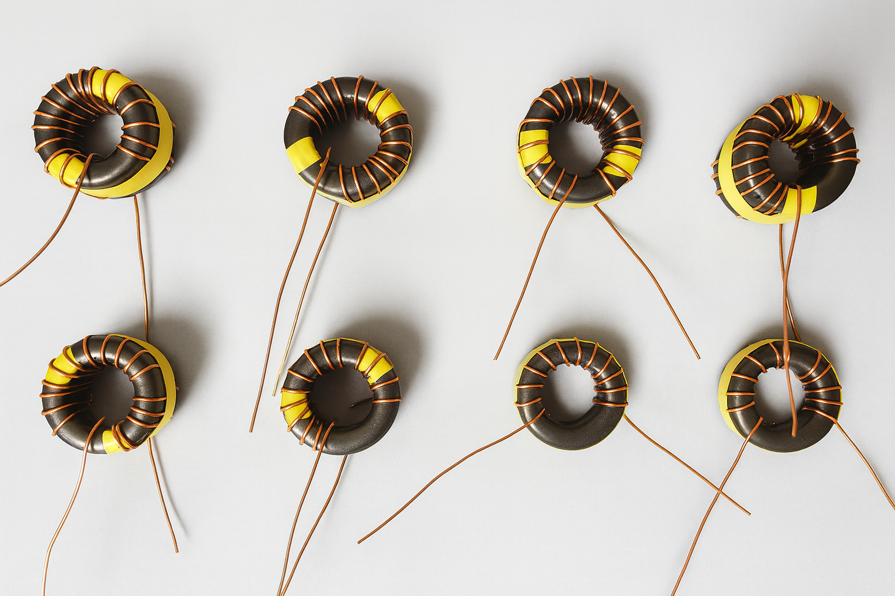

# Transformer construction

T1 and T2 provide the coupled sampling functions in the preserved directional bridge. Build the selected population on the same common PCB. The descriptions below separate owner-confirmed construction from the electrical drawing and unresolved physical details.

## Confirmed owner construction

| Item | 200 W: each T1 and T2 | 2 kW: each T1 and T2 |
|---|---|---|
| Ferrite | Fair-Rite 5943001401, material #43 | Same |
| Cores per transformer / complete board | 1 / 2 | 2 / 4 |
| Wound turns | 16 | 24 |
| Wire | 21 AWG high-temperature enameled copper | Same |
| Core preparation | Single toroid | Two toroids taped together before winding |
| Retained schematic notation | 1:16T | 1:24T |

The owner purchased the cores from DigiKey and Mouser; Mouser number 623-5943001401 is owner supplied. The [Fair-Rite product record](https://fair-rite.com/product/toroids-5943001401/) identifies the #43 toroid. Nominal outside diameter is 25.4 mm (±0.60), inside diameter 15.5 mm (±0.50), and height 8.15 mm per core. A two-core stack has nominal bare-core height 16.3 mm before tape and wire. Check the current manufacturer drawing when selecting mechanical clearance. Material data and core dimensions do not establish an assembled RF power rating. Manufacturer datasheets/models are linked, not bundled.

Wire manufacturer, enamel class, temperature rating, insulation thickness, supplier part number and required length are unspecified. Tape manufacturer, adhesive, thickness and insulation rating are also unspecified. The double-core construction was selected by the owner for increased power handling; no maximum-power qualification follows from that intent.

## Owner-described winding method

1. For 2 kW, tape two identical #43 toroids together before winding.
2. Hold the toroid or taped assembly in the left hand.
3. Wind the wire counterclockwise with the right hand.
4. Count one turn as a completed wrap when the wire returns to the starting position; continue to 16 or 24 turns as applicable.
5. Identify both winding ends before installation. Inspect the enamel for damage and ensure exposed termination areas cannot short adjacent pads or grounded metal.

This preserves the owner's method. The viewing face for “counterclockwise” is not recorded; the photograph does not resolve winding polarity. Do not choose a face, start/finish mapping or primary arrangement from this instruction alone. Do not reinterpret the retained 1:16T/1:24T notation as a verified electrical turns ratio.

## Verified schematic information

The embedded SWRBridge symbol draws a wound element between pins 1 and 2, with a polarity dot near pin 1. Pins 3 and 4 are the other depicted coupled conductor path. Pin 5 attaches to the depicted surrounding structure and is grounded. These are drawing facts; the symbol does not specify the physical conductor/shield fabrication or enamel lead routing.

| Pin | T1 connection | T2 connection |
|---|---|---|
| 1 | Net-(R1-Pad2), shared with T2 pin 4 | RF input node, J2 pin 1 / T1 pin 4 |
| 2 | GND | GND |
| 3 | RF output node, J1 pin 1 | Net-(R4-Pad2), shared with R6 pin 1 |
| 4 | RF input node, J2 pin 1 | Net-(R1-Pad2), shared with T1 pin 1 |
| 5 | GND | GND |

This table is taken from the curated KiCad netlist and is the same for both populations. T1's 3–4 path is in the main RF through path. T2's 1–2 wound element is connected between the RF input node and ground. Do not treat both wound elements as interchangeable isolated secondaries. Pad numbering and the drawn dot must be respected, but the physical winding start/finish to pad 1/2 correspondence still needs owner or hardware verification. Use the native schematic and PCB together; neither an experimental photo nor a vendor core model supplies a complete assembly drawing.

## Historical experimental evidence

Historical RayCoupler transformer winding experiments. These samples illustrate construction methods evaluated during RF StateSide LLC development. The photographed samples may not have the exact turn counts or configurations used in the final 200 W and 2 kW designs.

The unchanged file `raycoupler_toroid.png` was supplied from the owner's download of an RF StateSide website image. Attribution: RF StateSide LLC. The eight visible samples show varying winding/lead arrangements; no sample is assigned a verified final turn count. See [image provenance](images/README.md).

## Information requiring verification

Physical primary/coupled-conductor arrangement, pin-5 grounded structure, dot-to-winding-start correspondence, viewing direction, lead dressing, termination preparation, core retention and insulation/clearance against nearby conductors remain unspecified. Do not energize an assembly on an assumed mapping. Inspect an original device or obtain an owner-marked construction drawing before reproducing those details. The documented core/turn/wire recipe is established; a complete physical wiring instruction is not yet established.

Core procurement is counted once in the BOM Material row (two or four per PCB); T1/T2 assembly rows do not add another core purchase quantity. Wire and tape are as-needed consumables, not invented measured lengths.
